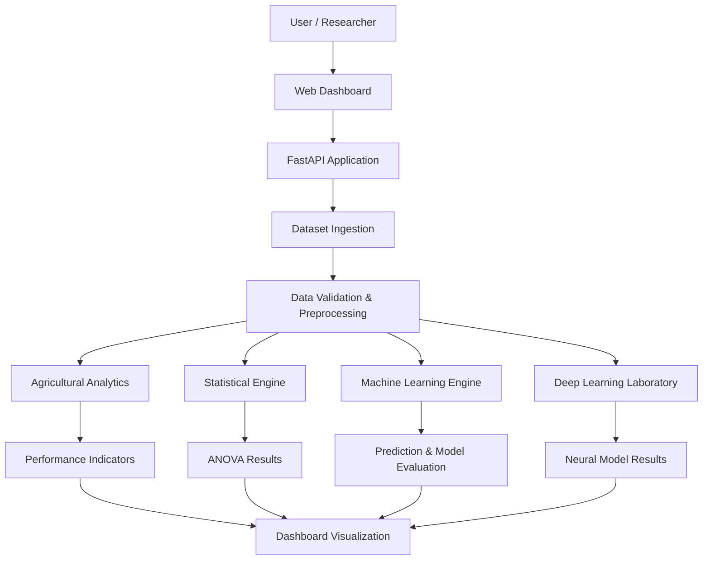
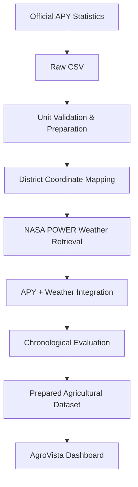

# 🌾 AgroVista
### AI-Powered Seasonal Agriculture Intelligence & Predictive Analytics

<p align="center">

  **Turning Agricultural Data into Intelligent Decisions.**

  An integrated agricultural analytics platform combining statistical intelligence, machine learning, predictive modelling, and interactive data visualization.

  <br/>

  
  
  
  
  

  **[Explore Repository](https://github.com/kishoreb13/AgroVista)**
  • **[Report an Issue](https://github.com/kishoreb13/AgroVista/issues)**

</p>

---

## 01. Project Overview

Agriculture is influenced by a complex interaction of environmental, seasonal, economic, and resource-related factors. Understanding these relationships is essential for evaluating crop performance and making informed agricultural decisions.

**AgroVista** is a full-stack Seasonal Agriculture Intelligence Platform developed to transform agricultural datasets into structured analytical insights.

It combines an interactive web dashboard with statistical techniques, classical machine learning algorithms, and experimental deep-learning models to investigate crop productivity, seasonal variations, agricultural risk indicators, and yield prediction scenarios.

Rather than focusing on individual agricultural measurements, AgroVista provides a unified environment for exploring relationships between crop yield, production, profit, water efficiency, weather conditions, and agricultural risk indicators.

### Core Objectives

- Analyze agricultural performance across crops and seasons.
- Evaluate productivity and resource-efficiency indicators.
- Identify statistical differences between seasonal yield groups.
- Benchmark multiple machine learning algorithms.
- Investigate feature importance and predictive relationships.
- Simulate yield estimates under user-defined agricultural scenarios.
- Support reproducible analysis using official crop statistics and weather data.

---

## 02. Platform Highlights

| Capability | Implementation |
|---|---|
| Agricultural Analytics | Interactive executive dashboard |
| Seasonal Intelligence | Crop-wise and seasonal comparisons |
| Performance Measurement | Agricultural Performance Index |
| Data Quality | Missing values, duplicate records and metadata |
| Statistical Intelligence | One-way ANOVA |
| Predictive Modelling | Three classical regression algorithms |
| Explainability | Permutation feature importance |
| Scenario Analysis | Random Forest yield estimator |
| Neural Modelling | MLP, Residual MLP and 1D CNN |
| Anomaly Analysis | Dense autoencoder reconstruction scoring |
| Data Engineering | APY and NASA POWER integration pipeline |
| Data Exchange | CSV import and seasonal summary export |

---

## 03. System Architecture

AgroVista follows a modular architecture separating frontend presentation, backend processing, dataset management, statistical analysis, and predictive modelling.



### Architectural Layers

**Presentation Layer**
- Responsive HTML interface.
- CSS-based dashboard styling.
- JavaScript-driven interactions and visualization.

**Application Layer**
- FastAPI application.
- Dataset upload and processing.
- Backend analytical operations.
- API documentation.

**Analytics Layer**
- Agricultural performance calculations.
- Seasonal comparisons.
- Statistical testing.
- Predictive model benchmarking.
- Scenario simulation.

**Data Layer**
- CSV-based demonstration data.
- External APY crop statistics.
- NASA POWER weather aggregates.
- Prepared and enriched datasets.

---

## 04. Technology Ecosystem

| Layer | Technologies |
|---|---|
| Programming | Python |
| Frontend | HTML5, CSS3, JavaScript |
| Backend | FastAPI |
| Server | Uvicorn |
| Data Processing | Pandas, NumPy |
| Statistical Computing | SciPy |
| Machine Learning | Scikit-learn |
| Deep Learning | PyTorch |
| Data Storage / Exchange | CSV |
| Development | Visual Studio Code |
| Version Control | Git, GitHub |

---

## 05. Intelligence Modules

### 5.1 Executive Agricultural Intelligence

Provides an aggregated overview of agricultural performance.

Key indicators:
- Crop yield.
- Total production.
- Profit.
- Agricultural Performance Index.
- Seasonal performance summaries.

### 5.2 Seasonal & Crop Analytics

Enables comparative investigation of agricultural productivity across:
- Crop categories.
- Agricultural seasons.
- Geographical regions.
- Production and yield measurements.

### 5.3 Agricultural Resource & Risk Analysis

Analyzes available indicators related to:
- Irrigation methods.
- Water consumption.
- Water efficiency.
- Disease risk.
- Pest risk.
- Environmental conditions.

### 5.4 Dataset Intelligence & Quality Assessment

Provides dataset-level inspection through:
- Dataset dimensions and metadata.
- Missing-cell analysis.
- Duplicate-row detection.
- Feature availability.
- CSV dataset import.

### 5.5 Predictive Intelligence

Supports model comparison, prediction evaluation, and feature-importance analysis.

### 5.6 Yield Scenario Simulation

Uses a Random Forest regression model to estimate yield for user-defined agricultural conditions.

Predictions are estimates based on the training dataset and should not be interpreted as guaranteed outcomes.

---

## 06. Agricultural Performance Index (API)

AgroVista implements a weighted composite indicator called the **Agricultural Performance Index**.

The objective is to combine multiple agricultural performance dimensions into a single comparative score.

### Mathematical Formulation

\[
API = 100 \times (0.30Y + 0.25P + 0.20W + 0.25R)
\]

Where:

| Variable | Description | Weight |
|---|---|---:|
| Y | Normalized crop yield | 0.30 |
| P | Normalized profit | 0.25 |
| W | Normalized water efficiency | 0.20 |
| R | Inverse normalized disease/pest risk | 0.25 |

### Normalization Strategy

- Percentile clipping is applied to selected numerical indicators.
- Min-max normalization brings the indicators to a common scale.
- Disease and pest risk are combined and inversely normalized.
- Weighted components are aggregated into a composite score.

**Methodological note:** The formula and weights represent project-defined assumptions. They are not an officially recognized agricultural index and should be validated before research or policy use.

---

## 07. Machine Learning Framework

AgroVista includes a comparative regression framework for agricultural yield estimation.

### 7.1 Model Benchmarking

| Model | Learning Approach | Role |
|---|---|---|
| Linear Regression | Linear regression | Baseline benchmark |
| Random Forest | Ensemble learning | Nonlinear prediction |
| Gradient Boosting | Boosting ensemble | Comparative prediction |

### 7.2 Evaluation Metrics

| Metric | Interpretation |
|---|---|
| MAE | Average absolute prediction error |
| RMSE | Error measure that penalizes larger deviations |
| R² | Proportion of target variance explained by the model |

### 7.3 Model Evaluation Protocol

- 80/20 train-test holdout.
- Random state: 42.
- Derived outcome variables and identifiers excluded to reduce leakage.
- Permutation-based feature importance.
- Held-out actual and predicted samples.

### 7.4 Model Explainability

Permutation feature importance evaluates how model performance changes when individual features are shuffled.

This helps investigate which input variables are important to the trained model.

Feature importance is not proof of causation.

---

## 08. Statistical Intelligence — One-Way ANOVA

The platform implements one-way Analysis of Variance to examine differences in average crop yield across seasonal groups.

### Hypotheses

**Null Hypothesis (H₀):**

All seasonal groups have equal mean crop yield.

**Alternative Hypothesis (H₁):**

At least one seasonal group has a different mean crop yield.

### Significance Interpretation

- p-value below 0.05: evidence against equal seasonal means.
- p-value at or above 0.05: insufficient evidence to reject equal means.

Further statistical investigation should include:
- Normality assessment.
- Homogeneity of variance.
- Residual diagnostics.
- Post-hoc pairwise testing.
- Confidence intervals.

ANOVA identifies statistical differences; it does not establish that season alone caused those differences.

---

## 09. Deep Learning Laboratory

The optional neural modelling module uses PyTorch to explore alternative approaches to agricultural tabular-data analysis.

| Architecture | Objective |
|---|---|
| Deep MLP | Nonlinear regression |
| Residual MLP | Deeper feature learning using residual connections |
| Feature-vector 1D CNN | Experimental convolution over encoded tabular features |
| Dense Autoencoder | Reconstruction-based anomaly scoring |

### Evaluation

Neural models report:
- MAE.
- RMSE.
- R².

Models use an 80/20 holdout and run on CPU by default.

**Experimental limitations:**

- The 1D CNN operates on encoded feature vectors, not chronological sequences.
- Autoencoder scores identify unusual feature patterns, not confirmed agricultural anomalies.
- LSTM/GRU forecasting requires genuine time-series observations and appropriate farm or district identifiers.

Install the optional deep-learning dependencies using:

```bash
python -m pip install -r requirements-dl.txt
```

---

## 10. Data Engineering & External Data Integration

AgroVista includes a reproducible pipeline for preparing agricultural statistics and environmental data.

### Supported Data Sources

| Source | Data |
|---|---|
| data.gov.in | District-wise, season-wise crop statistics |
| DES | Area, Production and Yield reports |
| UPAg | Agricultural statistics |
| NASA POWER | Weather and environmental aggregates |

### Data Engineering Workflow



### Preparation Pipeline

**1. APY data preparation**

```bash
python scripts/prepare_real_data.py --input data/raw/india_apy.csv --area-unit ha --production-unit tonnes
```

**2. Configure district locations**

Copy `data/locations_template.csv` to `data/locations.csv` and replace the example coordinates.

**3. Install data dependencies**

```bash
python -m pip install -r requirements-data.txt
```

**4. Download NASA POWER weather data**

```bash
python scripts/download_nasa_power_weather.py --locations data/locations.csv --start-year 2001 --end-year 2025
```

**5. Merge agricultural and weather data**

```bash
python scripts/merge_apy_weather.py
```

**6. Perform chronological evaluation**

```bash
python scripts/evaluate_temporal.py --input data/processed/agrovista_real_enriched.csv
```

**7. Import the prepared dataset**

Use the dashboard's **Import dataset** option.

Refer to `docs/REAL_DATA_GUIDE.md` for detailed preparation instructions, source units, provenance and spatial limitations.

### Data Integrity Policy

The platform does not fabricate:
- Soil measurements.
- NPK measurements.
- Irrigation measurements.
- Profit values.
- Disease measurements.
- Farm-level observations.

Unavailable information should remain unavailable rather than being represented as observed data.

---

## 11. Dataset Specification

### Demonstration Dataset

`data/demo_agricultural_dataset.csv`

| Attribute | Description |
|---|---|
| Records | 4,000 |
| Type | Synthetic demonstration data |
| Purpose | Application testing |
| Research suitability | Not suitable as empirical evidence |

### Real Dataset Requirements

The backend expects a yield target named:

`Yield_Tonnes_Ha`

Recognized equivalent names such as `Yield` may also be supported.

Recommended feature columns include:

| Category | Suggested Variables |
|---|---|
| Identification | Season, Crop, State |
| Production | Yield_Tonnes_Ha, Production_Tonnes |
| Land | Farm_Area_Ha |
| Economics | Profit_INR, Revenue_INR, Cost_INR |
| Water | Water_Efficiency, Water_Usage_L |
| Risk | Disease_Risk_Score, Pest_Risk_Score |
| Weather | Rainfall_mm, Temperature_C, Humidity_Percent |
| Soil | Soil_pH |
| Nutrients | Nitrogen_kg_ha, Phosphorus_kg_ha, Potassium_kg_ha |
| Irrigation | Irrigation_Method |

Uploaded CSV data is held in application memory for the current server process. Restarting the server restores the included demonstration dataset.

Do not upload sensitive personal information.

---

## 12. Installation & Execution

### Prerequisites

- Python 3.10–3.12.
- Git.
- Visual Studio Code.
- Windows, Linux or WSL Ubuntu.
- Internet connection for package installation.

### Clone Repository

```bash
git clone https://github.com/kishoreb13/AgroVista.git
cd AgroVista
```

### Create Virtual Environment

**Windows PowerShell**

```powershell
py -3.11 -m venv .venv
.\.venv\Scripts\Activate.ps1
```

**Ubuntu / WSL**

```bash
python3 -m venv .venv
source .venv/bin/activate
```

### Install Dependencies

```bash
python -m pip install --upgrade pip
python -m pip install -r requirements.txt
```

### Launch Backend

```bash
python -m uvicorn backend.main:app --reload --host 0.0.0.0
```

### Access Application

| Resource | Address |
|---|---|
| AgroVista Dashboard | [http://127.0.0.1:8000](https://agrovista-0w6v.onrender.com/) |
| Interactive API Documentation | [http://127.0.0.1:8000/docs](https://agrovista-0w6v.onrender.com/docs) |

Keep the terminal running while using the application.

---

## 13. Backend API Documentation

The application uses FastAPI for backend functionality and interactive API documentation.

After starting the server, access:

**Swagger UI:** `http://127.0.0.1:8000/docs`

**OpenAPI documentation:** `http://127.0.0.1:8000/openapi.json`

Backend source files:

```text
backend/
├── main.py
├── deep_learning.py
└── __init__.py
```

The API documentation generated by FastAPI provides the available routes, parameters, request formats and response schemas.

---

## 14. Repository Structure

```text
AgroVista/
│
├── backend/
│   ├── __init__.py
│   ├── main.py
│   └── deep_learning.py
│
├── frontend/
│   ├── index.html
│   ├── style.css
│   └── app.js
│
├── data/
│   ├── demo_agricultural_dataset.csv
│   ├── locations_template.csv
│   ├── raw/
│   └── processed/
│
├── scripts/
│   ├── download_nasa_power_weather.py
│   ├── prepare_real_data.py
│   ├── merge_apy_weather.py
│   ├── evaluate_temporal.py
│   └── ...
│
├── docs/
│   ├── DEEP_LEARNING.md
│   ├── METHODOLOGY.md
│   └── REAL_DATA_GUIDE.md
│
├── tests/
│   ├── __init__.py
│   └── test_api_smoke.py
│
├── requirements.txt
├── requirements-dl.txt
├── requirements-data.txt
├── .gitignore
└── README.md
```

---

## 15. Research Reproducibility & Limitations

AgroVista is an analytical platform, not a validated agricultural decision-support authority.

The following considerations apply when interpreting results:

**Dataset limitations**
- Demonstration outputs use synthetic data.
- Real-world analysis requires verified source data.
- Units, feature mappings and missing values must be checked.
- District-level weather aggregates do not represent every individual farm.

**Model limitations**
- Holdout results are dependent on the supplied dataset.
- Feature leakage must be evaluated for each dataset.
- Model predictions are estimates, not guarantees.
- Feature importance does not establish causal relationships.

**Temporal limitations**
- Random train-test splitting is not sufficient for temporal forecasting claims.
- Chronological validation is required for future-oriented evaluation.
- Farm-level time-series models require genuine repeated observations and sequence identifiers.

---

## 16. Development Roadmap

The following are potential future enhancements, not claims about currently implemented functionality.

- [ ] Add advanced post-hoc statistical testing.
- [ ] Introduce confidence intervals and residual diagnostics.
- [ ] Extend model validation with cross-validation.
- [ ] Add verified multi-year agricultural datasets.
- [ ] Improve district-level geographical analysis.
- [ ] Introduce genuine farm-level time-series forecasting.
- [ ] Explore LSTM and GRU models when suitable chronological data is available.
- [ ] Expand automated testing and deployment workflows.
- [ ] Add deployment documentation and reproducible experiment tracking.

---

## 17. Testing

The repository includes an API smoke-test file:

```text
tests/test_api_smoke.py
```

A test environment can be prepared with:

```bash
python -m pip install pytest
```

Run the tests using:

```bash
python -m pytest tests/ -v
```

---

## 18. Contributing

Contributions, suggestions and technical improvements are welcome.

Suggested workflow:

1. Fork the repository.
2. Create a feature branch.
3. Implement the proposed improvement.
4. Test the changes.
5. Submit a pull request with a clear description.

For bugs or feature suggestions, use the [GitHub Issues](https://github.com/kishoreb13/AgroVista/issues) page.

---

## 19. Project Information

| Field | Details |
|---|---|
| Project Name | AgroVista |
| Domain | Agriculture, AI & Data Analytics |
| Project Category | Full-Stack Application |
| Core Focus | Seasonal Agricultural Intelligence |
| Backend | FastAPI |
| ML Framework | Scikit-learn |
| DL Framework | PyTorch |
| Data Sources | APY Statistics and NASA POWER |
| Repository | [github.com/kishoreb13/AgroVista](https://github.com/kishoreb13/AgroVista) |

---

## 20. Acknowledgements & Data Sources

- [Python](https://www.python.org/)
- [FastAPI](https://fastapi.tiangolo.com/)
- [Scikit-learn](https://scikit-learn.org/)
- [PyTorch](https://pytorch.org/)
- [NASA POWER](https://power.larc.nasa.gov/)
- [data.gov.in](https://www.data.gov.in/)
- [Directorate of Economics and Statistics](https://data.desagri.gov.in/)
- [Unified Portal for Agricultural Statistics](https://www.upag.gov.in/)

---

<p align="center">

  **🌾 AgroVista — Intelligence for Smarter Agricultural Analysis.**

  *From agricultural data to meaningful analytical insights.*

  **Built with Python, Machine Learning & Data Intelligence.**

</p>
